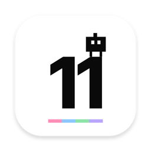
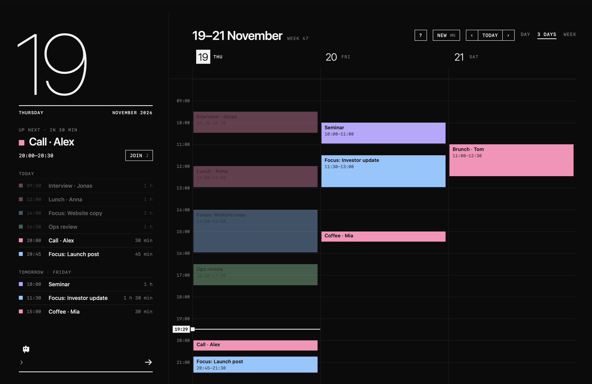

# Studio Calendar

Your calendar as your Mac desktop. One huge number, today on the left, your week on the right,
and a prompt at the bottom where Claude plans your day with you.

Folders on the desktop are a habit from another time. Studio Calendar replaces them with the
thing you actually look at all day: what is next.



**[Download for Mac](https://github.com/sundaymade/studio-calendar/releases/latest)** · macOS 14 or later ·
Apple Silicon and Intel · free and open source

1. Download `Studio-Calendar-….zip`, open it and drag **Studio Calendar** into Applications.
2. Open it. The first time, macOS says it cannot check the app: open **System Settings > Privacy & Security**,
   scroll down and click **Open Anyway**. (Or in Terminal: `xattr -dr com.apple.quarantine "/Applications/Studio Calendar.app"`.)
3. Allow Calendar access. Your calendar now sits on the desktop. The calendar icon in the menu bar picks which
   calendars to show, and has Quit and Launch at Login.
4. For the Claude prompt: install [Claude Code](https://code.claude.com) and sign in once in Terminal (`claude`).
   Everything else works without it.

Want to see it with a made-up week first? `open -a "Studio Calendar" --args --demo`

The repository has two parts:

- **The app** (Swift, this folder): the desktop calendar with the Claude prompt.
- **[Calendar merge](sync/)** (Google Apps Script): copies all your calendars (work Google, iCloud, …) into one
  Google calendar without duplicates, so the app and your phone only show that one.

## What it does

- Lives on the desktop: above the Finder icons, below every window. Swipe to the desktop and it is there.
- Reads and writes through macOS Calendar (EventKit), so changes sync to Google, iCloud or Exchange and show up on your phone.
- Day, 3 days, week. Flat colour blocks: meetings pink, focus blue, study lilac, work green.
- `⌘N`: type “Lunch tomorrow 1pm 45 min” (English or German) and it lands in the right slot.
- `⌘` + drag in the grid draws an event.
- The `›` prompt talks to Claude Code running on your Mac. Ask “When am I free on Friday?” or
  “Plan two focus sessions for the pitch tomorrow”. Claude proposes, you press Enter to apply.
  It can add, move, rename and delete events, never without your click.
- Paste a screenshot of a chat (`⌘V`), drop one on the calendar, or press `⌃⌥S` and drag over
  WhatsApp: Claude reads who, when and where and proposes the meeting. Copied chat text and dictation work too.
- “Save the contact”: from a screenshot or card, Claude proposes a contact and saves it to macOS Contacts on your click.
- Video calls get a Join button. `J` or `⌃⌥J` opens the call that is on now (Meet opens with the
  invited Google account).
- `⌃⌥C` puts your free times on the clipboard as a message you can send.
- A Focus block shows a big countdown and turns on Do Not Disturb (import the two files in `Shortcuts/` once).
- Morning (first time you are at the Mac, before noon): full screen, tick off what is already done,
  Claude fits the rest of your to-dos around the fixed things, one click puts it in.
- Evening (from 18:00, when you are at the Mac): tick off what got done, the rest moves to tomorrow
  or back onto your list.
- Invites: “Invite Alex for a call on Friday” proposes a real Google invite with a Meet link, with the address
  from your past meetings. Nothing is sent until you click “Send invite”. Needs the Google Calendar connector
  in your Claude account.
- [Claude Meetings](#claude-meetings), optional: Claude joins your Meet calls, and the app files the recap as a
  note and offers the action items in the evening check.
- A small square fellow lives on the prompt line. He sleeps at night.

## Keyboard

| Keys | Action |
| --- | --- |
| `⌘N` or `N` | New event |
| `⌘` + drag | Draw an event |
| `⌘K` or `/` | Talk to Claude |
| `↩` in an empty prompt | Apply Claude’s suggestion |
| `⌘⇧K` | New chat |
| `⌘1` `⌘2` `⌘3`, `D` `W` | Day, 3 days, week |
| `←` `→`, `T` | Previous, next, today |
| `⌘⌫` | Delete the selected event |
| `⌃⌥K` | Calendar to the front and back, from any app |
| `⌃⌥Space` | Ask Claude from any app |
| `⌘V`, drop | Screenshot or chat text to Claude |
| `⌃⌥S` | Screenshot to Claude, from any app (asks once for Screen Recording) |
| `J`, `⌃⌥J` | Join the call that is on now |
| `⌃⌥C`, `⌘⇧C` | Free times as a message on the clipboard |
| `M`, `E` | Morning plan, evening check |
| `esc` | Close |

## Build from source

Requires macOS 14+ and the Xcode command line tools. For the prompt, [Claude Code](https://code.claude.com)
installed and logged in.

```sh
git clone https://github.com/sundaymade/studio-calendar.git
cd studio-calendar
./build.sh          # builds, signs and opens ~/Applications/Studio Calendar.app
```

macOS asks for Calendar access on first launch. Contacts and Screen Recording are only asked for when you use them.

Signing: put `SIGN_IDENTITY="<your identity hash>"` into a file `.signing` (ignored by git) or the environment.
Without it the app is signed ad hoc, and macOS may ask for permissions again after every build.

`./release.sh` builds the universal app and the zip for a GitHub release (notarized when `RELEASE_IDENTITY` and
`NOTARY_PROFILE` are set). The icon comes from `Resources/icon/icon.html` (`Resources/icon/make-icon.sh`).

## Settings

Calendars to show, the calendar for new events and the display are in the menu bar icon.
Everything personal is in `defaults`, nothing is in the code:

```sh
D=works.sonntag.studiocalendar
defaults write $D userName "Alex"                         # name Claude uses (default: your macOS first name)
defaults write $D replyLanguage "German"                  # language for Claude's notes (default: the Mac's)
defaults write $D messageStyle -string 'German, "Du", 1–2 short sentences'   # how drafted messages sound
defaults write $D calendarTitle "you@example.com"         # calendar for new events on first launch
defaults write $D dayStart -int 8                         # working hours for free time
defaults write $D dayEnd -int 20
defaults write $D morningHour -int 6                      # morning plan from (until noon)
defaults write $D eveningHour -int 18                     # evening check from
defaults write $D workLabel "Acme"                        # name of your work colour
defaults write $D workKeywords -array "acme" "client"     # title words that mean work
defaults write $D studyLabel "Uni"
defaults write $D studyKeywords -array "lecture" "seminar" "exam"
defaults write $D claudeModel sonnet                      # model for the prompt
defaults write $D claudePath /path/to/claude              # if Claude Code is not found
```

## Claude

The prompt runs your locally installed Claude Code (`claude -p`) with no tools and a planner prompt that contains
your next 14 days, your free time, names and addresses of people from your past meetings and, if you use it,
your to-do list. That is what goes to Claude, through your own Claude Code login. The app has no server and
collects nothing.

Invites and meeting notes use the Google Calendar and Gmail connectors of your Claude account, each call
limited to the few tools it needs (list/create/update events; search/read mail). The app only starts them
after your click, or, for meeting notes, read-only.

This is a personal tool, not affiliated with Anthropic. Anthropic’s terms say products for other people should
use API keys, not someone’s Claude subscription. Here every user runs their own Claude Code on their own Mac.

## Claude Meetings

[Claude Meetings](https://claude.ai/meetings) (Team and Enterprise plans, Google Meet) lets Claude join your
calls and mail a recap. Studio Calendar connects it to your calendar:

1. In claude.ai, connect the Google account Claude Meetings should use and turn on auto-join.
2. Tell the app that account:
   ```sh
   defaults write works.sonntag.studiocalendar claudeMeetingsAccount you@company.com
   defaults write works.sonntag.studiocalendar meetingNotesFolder "$HOME/Documents/Notes/Meetings"
   ```
3. Every Meet invite the app sends now includes that account, so Claude joins. “+ Claude” on any upcoming
   meeting adds it (and a Meet link) without mailing anyone else.
4. After the call the app reads the recap mail, writes a Markdown note into `meetingNotesFolder` and offers the
   action items in the evening check. Only the ones you tick go on your list.

Turn it off with `defaults write works.sonntag.studiocalendar claudeMeetings -bool false`.

## To-dos (optional)

“Plan my day”, the morning plan and the evening check can read and tick off to-dos from
Measure, my own to-do app (not public), from `~/Library/Application Support/worktime-local/notes.json`
(`measureFolder` to change). If that file does not exist, the app simply works without to-dos.

## Roadmap

- iPhone: widgets for the Home Screen, Lock Screen and StandBy (iOS has no live wallpaper API).
- API-key mode for Claude, so the app can go to the Mac App Store (sandboxed apps cannot run the CLI).
- Drag to move and resize events.

## License

MIT for the app. The calendar merge in `sync/` is GPL-3.0-or-later, like GAS-ICS-Sync it builds on.
